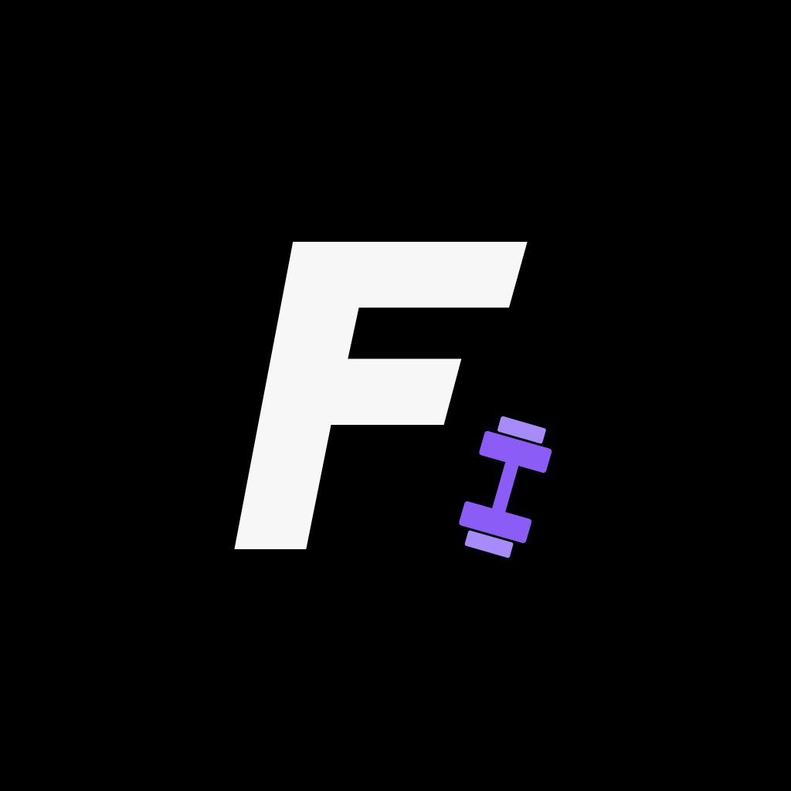
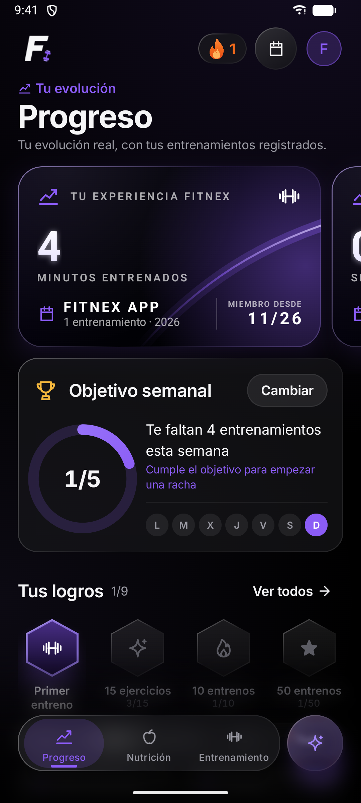
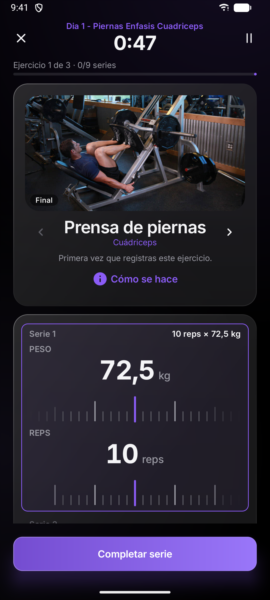
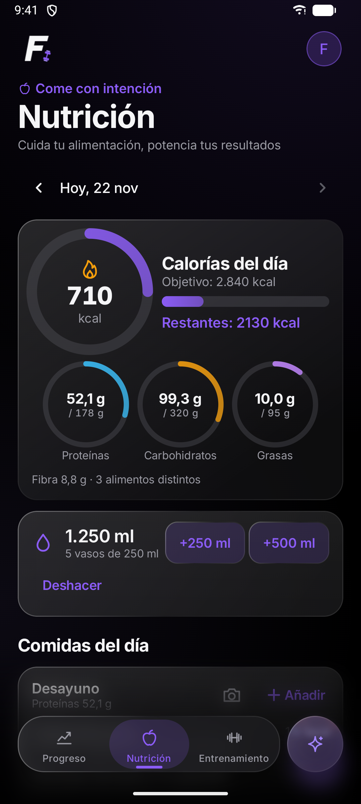
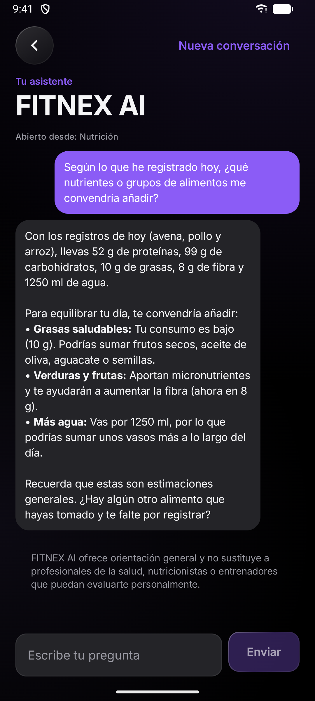

<p align="center">
  
</p>

<h1 align="center">FITNEX</h1>
<p align="center"><b>Entrenamiento, nutrición y progreso en una sola app, con IA.</b><br>
Código abierto · Android · Hecha en español</p>

<p align="center">
  
  
  
  
</p>

> **Estado:** versión de prueba (1.7.0). Todavía no está en Google Play: la publicación está prevista para
> **enero de 2027**. Mientras tanto puedes instalar el APK de la sección **Releases** y contarnos qué te parece.

## Qué hace

- **Entrenamiento en vivo:** eliges peso y repeticiones deslizando una regla, ves tu última marca y tus récords,
  temporizador de descanso con aviso y contador de repeticiones con la cámara en algunos ejercicios.
- **611 ejercicios** con técnica, músculos y errores frecuentes; 501 con fotos.
- **Mapa muscular 2D y 3D:** qué músculos has trabajado y cuánto.
- **FITNEX AI:** asistente que conoce tus datos (solo si le das permiso) y crea rutinas o planes semanales con tu
  equipo y tu tiempo.
- **Nutrición:** diario por comidas con 212 alimentos, agua, porciones, escáner de código de barras, recetas, plan
  de comidas y foto de la comida analizada por la IA.
- **Progreso:** estadísticas, gráficas, récords, calendario, racha diaria y logros.
- **Widgets** de racha y estadísticas para la pantalla de inicio.
- **Personalización:** tema claro u oscuro, color de acento, Liquid Glass, «Reducir animaciones».
- **Entrenar juntos:** varios perfiles en el mismo móvil para entrenar con amigos o familia.
- **Menores protegidos:** de 14 a 17 años la app no muestra calorías, peso ni objetivos estéticos.
- **Privacidad:** todo se guarda en el móvil; la copia en la nube es opcional y solo tuya. Ver
  [docs/PRIVACIDAD.md](docs/PRIVACIDAD.md).

## Instalar la versión de prueba

1. Descarga el APK más reciente desde **Releases**.
2. En el móvil, permite instalar apps de origen desconocido para tu navegador o gestor de archivos.
3. Ábrelo e instálalo. Necesitas Android 8.0 o superior y un móvil de 64 bits.

Los APK de prueba están firmados con una clave de desarrollo: cuando la app llegue a Google Play tendrás que
desinstalar la versión de prueba e instalar la de la tienda.

## Compilar desde el código

Necesitas Android Studio (con su JDK incluido, 17 o superior) y la plataforma Android 37 del SDK.

```powershell
git clone https://github.com/<tu-usuario>/fitnex.git
cd fitnex
.\gradlew.bat assembleDebug testDebugUnitTest
```

Para iniciar sesión, sincronizar y usar FITNEX AI necesitas **tu propio** proyecto de Firebase y, si quieres la IA,
tu propio servidor. Paso a paso en [docs/CONFIGURAR.md](docs/CONFIGURAR.md).

## Cómo está hecho

| Parte | Tecnología |
|---|---|
| App | Kotlin, Jetpack Compose, Hilt, Room, DataStore, WorkManager, Glance (widgets), CameraX + ML Kit |
| Arquitectura | Multimódulo: `app`, `core/*` (datos, base de datos, diseño, red, anatomía…) y `feature/*` (una por sección) |
| Servidor | Cloudflare Workers + D1 (`backend/worker`): FITNEX AI con Google Gemini y la copia en la nube |
| Cuentas | Firebase Authentication (correo y contraseña) |
| Pruebas | 227 pruebas unitarias y de interfaz (JUnit + Robolectric) y 14 del servidor |

La clave de Gemini **nunca** está en la app: vive solo en el servidor. El historial completo del desarrollo,
fase por fase, está en [docs/HISTORIAL.md](docs/HISTORIAL.md).

## Ayúdanos

FITNEX se está construyendo con la comunidad. Puedes:

- **Probarla y opinar:** abre un *issue* con lo que te gusta, lo que no o lo que le falta.
- **Proponer funciones** o **votar** las que ya están propuestas.
- **Contribuir con código, traducciones o ejercicios:** lee [CONTRIBUTING.md](CONTRIBUTING.md).

## Licencia

El código de FITNEX es software libre bajo la licencia **GNU GPL v3.0** ([LICENSE](LICENSE)): puedes usarlo,
estudiarlo, modificarlo y compartirlo, siempre que las versiones modificadas que distribuyas también sean
libres y con su código disponible.

El nombre y el logo de FITNEX identifican este proyecto; si publicas una versión modificada, usa otro nombre y
otro logo. Los recursos de terceros (fotos, alimentos, modelo 3D, tipografía) tienen sus propias licencias:
ver [CREDITOS.md](CREDITOS.md).
